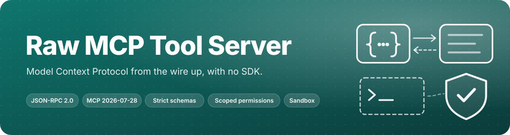
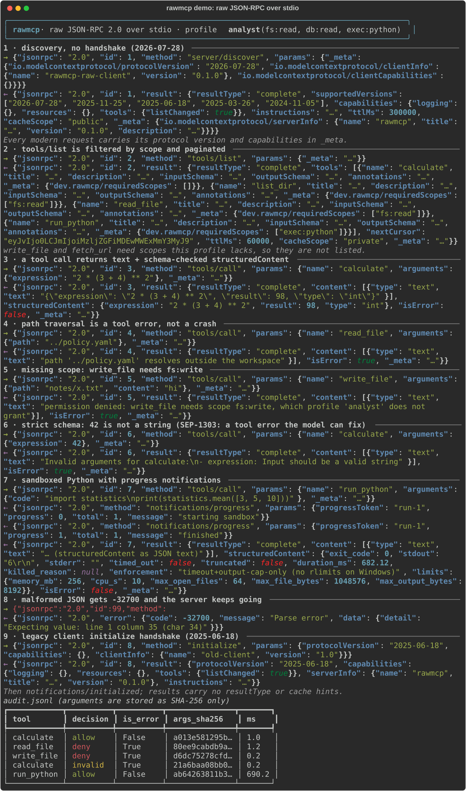
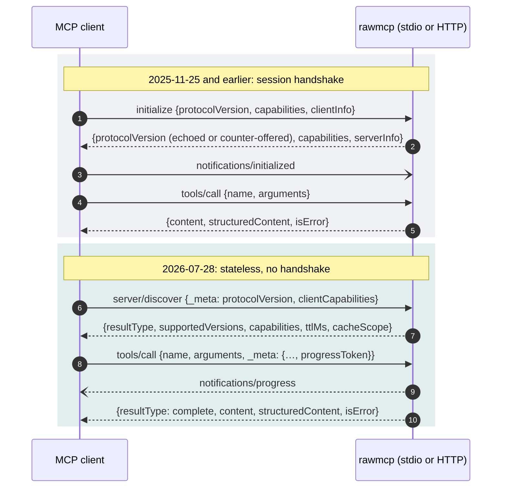
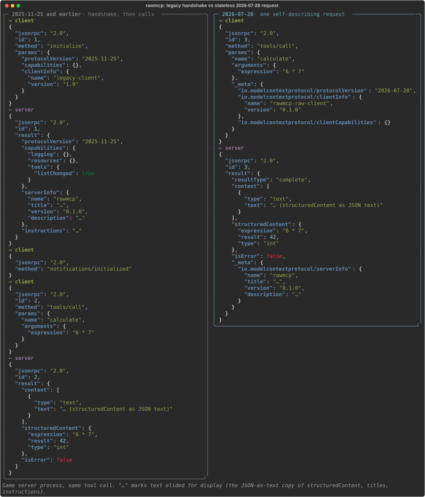
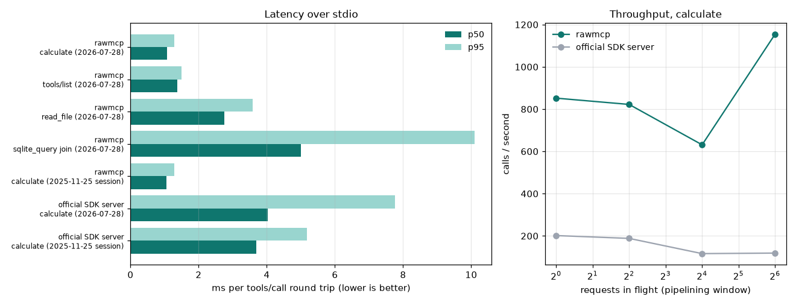

<p align="center">
  
</p>

<p align="center">
  <a href="https://github.com/iamsammy-ak/raw-mcp-tool-server/actions/workflows/ci.yml"></a>
  
  
  
  <a href="LICENSE"></a>
</p>

**Raw MCP Tool Server** (`rawmcp`) is a Model Context Protocol (MCP) server written from the JSON-RPC 2.0 layer
up, without the MCP SDK. It speaks the current protocol revision, **2026-07-28** (stateless, with
`server/discover`), and still negotiates the four handshake-era revisions back to 2024-11-05. Its eight tools sit
behind strict Pydantic schemas, a deny-by-default permission policy, a filesystem jail, an egress allowlist and a
subprocess sandbox, and every call is written to a JSONL audit log.



<sub>`python -m rawmcp demo`: a scripted session against a real server process. Long schemas and repeated
`_meta` blocks are shown as "…"; everything else is the JSON that crossed the pipe. Recorded on Windows, hence the
sandbox line saying memory and CPU limits are not enforced there.</sub>

## Why this exists

An MCP SDK makes a tool server a few decorators long, and that is the problem when you have to secure one: the
parts that decide what happens under attack are hidden. Which JSON-RPC error does a truncated message get? What does
the server do with a request whose `id` is `null`, or with a batch? How does a 2025-06-18 client differ from a
2026-07-28 one? Who is allowed to call `write_file`, and can `../` or a symlink get it out of the workspace?

MCP tools are called by a language model, so anything that can reach the model's context (a web page, a file, an
email) can try to steer those calls. A tool server therefore needs the controls a public API would have:
authenticated callers, least privilege, input validation, rate limits, isolation for risky work and an audit trail.
This repository implements the protocol and those controls by hand, and tests them against the official SDK client.

## Features

| | |
|---|---|
| 🔌 **JSON-RPC 2.0 from scratch** | Parse errors, invalid requests, id rules (string or integer, never `null`), notifications, and batches only where a revision allows them (2025-03-26) |
| 🧭 **Dual-era MCP** | Stateless 2026-07-28 with per-request `_meta` and `server/discover`; the `initialize` handshake for 2025-11-25, 2025-06-18, 2025-03-26 and 2024-11-05, with results shaped to each revision |
| 🧱 **Strict schemas** | Each tool has a Pydantic input model (`extra="forbid"`, strict types) that becomes its `inputSchema`, and an output model that becomes its `outputSchema`; `structuredContent` is re-validated before it is sent |
| 🔐 **Permission scoping** | YAML policy maps profiles and hashed bearer tokens to scopes (`fs:read`, `fs:write`, `net:fetch`, `exec:python`, `db:read`); deny by default; `tools/list` shows only what the caller may call; per-tool rate limits; hot reload |
| 📁 **Filesystem jail** | Paths resolved with `realpath` and checked for containment, so `../`, absolute paths, drive letters and escaping symlinks are refused; results never reveal where the server lives |
| 🌐 **Egress allowlist** | HTTPS only, allowlisted domains, every resolved address must be public (blocks `127.0.0.1` and cloud metadata), redirects re-checked, body size capped |
| 🧪 **Sandboxed Python** | Separate process, wall-clock timeout, POSIX `setrlimit` (memory, CPU, files), scrubbed environment, throwaway directory, output cap, audit hook that blocks network and process modules |
| 🗄️ **Read-only SQL** | Bundled synthetic SQLite database opened read-only, `query_only`, an authorizer that allows reads only, and a 2-second statement budget |
| 📡 **Two transports** | stdio (stdout carries protocol only, logs go to stderr) and Streamable HTTP (one `/mcp` endpoint, `Origin` and `Host` checks, header mirroring, legacy sessions, SSE when there is something to stream) |
| ⏱️ **Live behaviour** | Progress notifications, cancellation that kills the subprocess or interrupts SQLite, `notifications/tools/list_changed`, `subscriptions/listen`, per-request and legacy log levels, cursor pagination |
| 🧾 **Audit log** | One JSONL line per `tools/call`: who, tool, SHA-256 of the arguments, decision, error flag and duration |
| ✅ **Conformance and fuzzing** | The official MCP SDK client drives the server over stdio and HTTP in both eras; Hypothesis and a 10,000-case black-box campaign check it never crashes |

## How it works

The handshake differs by era. Older clients open a session; 2026-07-28 clients put the version and capabilities on
every request, so any request can be the first one.





Every `tools/call` then goes through the same pipeline:


1. **Framing** (`jsonrpc.py`). A line or POST body is decoded strictly (invalid UTF-8, `NaN` and nesting deeper
   than 64 are parse errors) and classified as request, notification or response. Errors whose id cannot be read
   omit `id`, as the MCP schema allows.
2. **Era detection** (`server.py`). A request carrying `_meta["io.modelcontextprotocol/protocolVersion"]` is served
   statelessly; an `initialize` request opens a legacy session for that connection; anything else is
   `-32602` with the supported versions listed. Unsupported modern versions get `-32022`.
3. **Authorisation** (`policy.py`, `ratelimit.py`). The caller's profile comes from `--profile` or `RAWMCP_TOKEN` on
   stdio and from `Authorization: Bearer` on HTTP. Missing scopes and exhausted rate limits are returned as tool
   errors (`isError: true`) so a model can read why.
4. **Validation** (`tools/base.py`). Arguments go through the tool's strict Pydantic model. On 2025-11-25 and later
   a failure is a tool error the model can fix (SEP-1303); on older revisions it is JSON-RPC `-32602`, as those
   specifications require.
5. **Execution** (`tools/`, `jail.py`, `sandbox.py`). Each tool enforces its own boundary and reports progress and
   honours cancellation through a `ToolContext`.
6. **Output and audit**. `structuredContent` is checked against the tool's output model, mirrored as JSON text for
   older clients, recorded in the audit log, and shaped for the negotiated revision (no `outputSchema` or
   `structuredContent` before 2025-06-18, no annotations before 2025-03-26, `resultType` and cache hints only on
   2026-07-28).

### Tools

| Tool | Scope | What it does | Guard |
|---|---|---|---|
| `read_file` | `fs:read` | Read a UTF-8 file (size-capped, binary refused) | jail |
| `list_dir` | `fs:read` | List a directory; symlinks reported, never followed | jail |
| `search_files` | `fs:read` | Literal text search with progress notifications | jail, file and result caps |
| `write_file` | `fs:write` | Create, overwrite or append | jail, `O_NOFOLLOW`, size cap |
| `sqlite_query` | `db:read` | One `SELECT` on the bundled synthetic retail database | read-only open, authorizer, time budget |
| `fetch_url` | `net:fetch` | GET a text resource | HTTPS, allowlist, public-address check, redirect re-check |
| `run_python` | `exec:python` | Run a snippet | subprocess sandbox |
| `calculate` | none | Arithmetic via an AST whitelist, never `eval` | node and integer-size limits |

## Benchmarks

All numbers come from scripts in `benchmarks/`; results are in `benchmarks/results/` as JSON and Markdown.

**Latency and throughput over stdio** (`PYTHONPATH=src python benchmarks/bench_stdio.py`). Each scenario starts a
fresh server process and sends raw JSON-RPC lines; latency is from writing a request to reading its response with
one request in flight. The baseline is the official MCP Python SDK 2.3.0 `MCPServer` serving the same `calculate`
function (`benchmarks/sdk_baseline_server.py`), so the gap is protocol and framework overhead, not tool work.

| Scenario (stdio, one request in flight) | p50 ms | p95 ms | p99 ms |
|---|---:|---:|---:|
| rawmcp · calculate (2026-07-28) | 1.08 | 1.29 | 2.12 |
| rawmcp · tools/list (2026-07-28) | 1.37 | 1.50 | 2.12 |
| rawmcp · read_file (2026-07-28) | 2.76 | 3.59 | 4.98 |
| rawmcp · sqlite_query join (2026-07-28) | 5.00 | 10.10 | 17.38 |
| rawmcp · run_python sandbox (2026-07-28) | 305.15 | 389.57 | 422.53 |
| rawmcp · calculate (2025-11-25 session) | 1.06 | 1.29 | 1.41 |
| official SDK server · calculate (2026-07-28) | 4.02 | 7.76 | 18.48 |
| official SDK server · calculate (2025-11-25 session) | 3.69 | 5.18 | 7.48 |

| Pipelined `calculate` (requests in flight) | 1 | 4 | 16 | 64 |
|---|---:|---:|---:|---:|
| rawmcp, calls/s | 852 | 822 | 631 | 1,155 |
| official SDK server, calls/s | 202 | 188 | 116 | 119 |



Measured on a Windows-11 laptop (12 logical CPUs, Python 3.13.2) that was busy with other work: a fixed CPU loop took 662 ms before and 860 ms after the run, several times its idle time, so treat absolute numbers as pessimistic and the throughput curve as noisy. What holds up across runs: a `tools/call` round trip on rawmcp takes about 1.1 ms against 4.0 ms for the SDK server doing the same work, the two eras cost the same, and `run_python` is dominated by starting a Python process (far cheaper on Linux).

**Fuzzing** (`PYTHONPATH=src python benchmarks/fuzz_campaign.py --cases 10000 --seed 7`). 10,000 seeded cases (random bytes, random JSON, mutated valid requests, truncated messages, nesting up to 3,000 levels, batches and bodies up to 200 KB), each followed by a sentinel `ping`: **0 crashes, 0 non-JSON-RPC lines on stdout, 0 internal errors (`-32603`)**, clean exit at end of input. Replies: 3,145 parse errors, 4,588 invalid requests, 563 invalid params, 162 unknown methods, 621 tool errors and 501 successful results. The test suite adds Hypothesis properties for the message handler and the stdin line splitter.

**Permission matrix** (`PYTHONPATH=src python benchmarks/permission_matrix.py`), using the profiles in
`examples/policy.yaml` and a fake network (nothing leaves the machine; the jail, sandbox and SQLite guards are real):

| Tool | Required scopes | anonymous | reader | analyst | maintainer |
|---|---|---|---|---|---|
| `calculate` | (none) | ⛔ deny | ✅ allow | ✅ allow | ✅ allow |
| `list_dir` | fs:read | ⛔ deny | ✅ allow | ✅ allow | ✅ allow |
| `read_file` | fs:read | ⛔ deny | ✅ allow | ✅ allow | ✅ allow |
| `search_files` | fs:read | ⛔ deny | ✅ allow | ✅ allow | ✅ allow |
| `sqlite_query` | db:read | ⛔ deny | ✅ allow | ✅ allow | ✅ allow |
| `fetch_url` | net:fetch | ⛔ deny | ⛔ deny | ✅ allow | ✅ allow |
| `run_python` | exec:python | ⛔ deny | ⛔ deny | ✅ allow | ✅ allow |
| `write_file` | fs:write | ⛔ deny | ⛔ deny | ⛔ deny | ✅ allow |

The same script runs 22 attack scenarios (traversal, absolute and drive paths, `DROP TABLE`, `ATTACH`,
runaway recursive SQL, non-allowlisted domains, an allowlisted name resolving to `169.254.169.254`, a redirect to
another domain, `import socket`, reading outside the sandbox, reading the parent's environment, `os.system`, an
infinite loop, a print flood, code injection into `calculate`, oversized powers, wrong argument types and a rate
limit). All 21 that ran were refused or contained; the symlink case needs extra privileges on Windows, where the
committed results were produced, and is covered by unit tests that run in Linux CI. The full table with server
messages is in
[`benchmarks/results/permission_matrix.md`](benchmarks/results/permission_matrix.md).

## Quick start

```bash
git clone https://github.com/iamsammy-ak/raw-mcp-tool-server.git
cd raw-mcp-tool-server
python -m venv .venv
source .venv/bin/activate        # Windows: .venv\Scripts\activate
pip install -e ".[dev]"
python -m rawmcp demo
```

No API key or network access is needed. `.env.example` exists only for parity with the owner's other repositories;
this server makes no LLM calls.

**Serve over stdio** with the example policy (profiles `reader`, `analyst`, `maintainer`):

```bash
python -m rawmcp tools --policy examples/policy.yaml --profile reader
python -m rawmcp serve --policy examples/policy.yaml --profile reader
```

Without `--policy` the server uses a built-in read-only policy for the current directory. On stdio the profile can
also come from `RAWMCP_TOKEN`, matched against the SHA-256 digests in the policy (`python -m rawmcp hash-token
<token>` prints one).

**Connect an MCP host.** Most hosts accept a JSON entry like this (see
[`examples/host-config.json`](examples/host-config.json)); use absolute paths:

```json
{
  "mcpServers": {
    "rawmcp": {
      "command": "python",
      "args": ["-m", "rawmcp", "serve", "--policy", "/absolute/path/to/raw-mcp-tool-server/examples/policy.yaml", "--profile", "reader"],
      "env": { "PYTHONPATH": "/absolute/path/to/raw-mcp-tool-server/src" }
    }
  }
}
```

With the package installed (`pip install -e .`) the `PYTHONPATH` entry is unnecessary and `rawmcp` works as the
command.

**Serve over Streamable HTTP** on `127.0.0.1:8706` (bearer tokens from the example policy):

```bash
python -m rawmcp serve --transport http --policy examples/policy.yaml
curl -s http://127.0.0.1:8706/mcp \
  -H "Authorization: Bearer demo-reader-token" \
  -H "Content-Type: application/json" -H "Accept: application/json, text/event-stream" \
  -H "MCP-Protocol-Version: 2026-07-28" -H "Mcp-Method: tools/call" -H "Mcp-Name: calculate" \
  -d '{"jsonrpc":"2.0","id":1,"method":"tools/call","params":{"name":"calculate","arguments":{"expression":"6*7"},"_meta":{"io.modelcontextprotocol/protocolVersion":"2026-07-28","io.modelcontextprotocol/clientCapabilities":{}}}}'
```

The reply (one line on the wire, wrapped here):

```json
{"jsonrpc":"2.0","id":1,"result":{"resultType":"complete","content":[{"type":"text","text":"{\"expression\": \"6 * 7\", \"result\": 42, \"type\": \"int\"}"}],
 "structuredContent":{"expression":"6 * 7","result":42,"type":"int"},"isError":false,"_meta":{"io.modelcontextprotocol/serverInfo":{"name":"rawmcp", ...}}}}
```

Without a token the endpoint answers `401`; with a foreign `Origin` it answers `403` and a JSON-RPC error without an `id`. Legacy clients get an `Mcp-Session-Id` from `initialize` and send it back on every request.

## Use it as a library

Tools are small classes: a strict input model, an output model, the scopes they need and an async `run`. This is
[`examples/custom_tool.py`](examples/custom_tool.py) in full:

```python
from __future__ import annotations

import asyncio
import json
from pathlib import Path

from pydantic import Field

from rawmcp.client import modern_meta
from rawmcp.context import Principal, ToolContext
from rawmcp.jail import Jail
from rawmcp.policy import load_policy
from rawmcp.server import McpServer
from rawmcp.tools import Tool, ToolError, ToolInput, ToolOutput, build_tools


class WordCountInput(ToolInput):
    path: str = Field(min_length=1, max_length=1024, description="Text file relative to the workspace.")


class WordCountOutput(ToolOutput):
    path: str
    lines: int
    words: int


class WordCount(Tool):
    name = "word_count"
    title = "Word count"
    description = "Count lines and words in a workspace text file."
    input_model = WordCountInput
    output_model = WordCountOutput
    scopes = frozenset({"fs:read"})

    def __init__(self, jail: Jail) -> None:
        self.jail = jail

    async def run(self, args: WordCountInput, ctx: ToolContext) -> WordCountOutput:
        path = self.jail.resolve(args.path)  # raises for traversal, absolute paths and escaping symlinks
        if not path.is_file():
            raise ToolError(f"not a file: {args.path}")
        text = path.read_text(encoding="utf-8", errors="replace")
        return WordCountOutput(path=self.jail.display(path), lines=len(text.splitlines()), words=len(text.split()))


async def main() -> None:
    policy = load_policy(Path(__file__).resolve().parent / "policy.yaml")
    server = McpServer(policy, tools=[*build_tools(policy), WordCount(Jail(policy.workspace))])
    replies: list[dict] = []

    async def send(message: dict) -> None:
        replies.append(message)

    connection = server.connect("in-process", Principal("reader", "example"), send)
    request = {"jsonrpc": "2.0", "id": 1, "method": "tools/call",
               "params": {"name": "word_count", "arguments": {"path": "notes/todo.txt"}, "_meta": modern_meta()}}
    await connection.feed(json.dumps(request))
    await connection.close(drain_timeout_s=5)
    print(json.dumps(replies[0]["result"]["structuredContent"]))
    schema = next(t for t in server.all_tools() if t.name == "word_count").input_schema()
    print(json.dumps(schema))


asyncio.run(main())
```

```text
$ PYTHONPATH=src python examples/custom_tool.py
{"path": "notes/todo.txt", "lines": 3, "words": 15}
{"additionalProperties": false, "properties": {"path": {"description": "Text file relative to the workspace.", "maxLength": 1024, "minLength": 1, "type": "string"}}, "required": ["path"], "type": "object"}
```

Other runnable examples: [`examples/raw_session.py`](examples/raw_session.py) (JSON lines over a pipe, nothing
else) and [`examples/sdk_client.py`](examples/sdk_client.py) (the official SDK client in both eras).

## Design decisions

- **Dual-era instead of one revision.** The 2026-07-28 revision removed the handshake, sessions, `ping` and
  `logging/setLevel`, so a server that only speaks it is unreachable for most hosts in use today, and a server stuck
  on 2025-11-25 is already legacy. Serving both costs a second code path; a table of per-revision feature flags
  (`versions.py`) keeps every difference (batching, `structuredContent`, error codes, result shape) in one place.
- **Pydantic models as the single source of truth for schemas.** The alternative was hand-written JSON Schema plus a
  validator such as `jsonschema`, which adds a runtime dependency and lets the advertised schema drift from the
  checks. Generating `inputSchema`/`outputSchema` from the models that do the validating removes the drift; the
  cost is Pydantic's verbose output, trimmed by stripping generated titles and cached because generation takes
  milliseconds.
- **Policy refusals are tool errors, malformed requests are protocol errors.** A model can recover from "needs
  scope fs:write" or "path resolves outside the workspace" if it reads them, so they come back as `isError: true`
  results. Unknown tools, broken params and missing `_meta` stay JSON-RPC errors because no retry with the same
  intent will fix them. Argument validation switches between the two by revision, as the specifications do.
- **Deny by default, and hide what you cannot call.** `tools/list` is filtered by the caller's scopes (marked
  `cacheScope: "private"` so shared caches do not mix callers). Listing everything and failing at call time would
  advertise capabilities to callers who cannot use them and spend model tokens on dead tools.
- **A subprocess sandbox, honestly labelled.** In-process options (`exec` with restricted globals, RestrictedPython)
  share memory with the server and have a long history of escapes. A container or gVisor would be stronger but
  would make the project depend on Docker. A separate process with rlimits, a scrubbed environment and an audit
  hook is a reasonable middle; the README, tool description and every result say what the platform enforces.
- **A thread for stdin, a task per request.** `asyncio` pipe readers do not work reliably on Windows, so a daemon
  thread reads stdin and hands lines to the event loop; each request then runs as its own task, which is what makes
  cancellation and concurrent slow tools work. The thread reads 64 KiB chunks and hands over every complete line at
  once: reading line by line cost a GIL hand-off per message and made pipelined clients slower than sequential ones.

## Project structure

```
raw-mcp-tool-server/
├── src/rawmcp/
│   ├── jsonrpc.py            JSON-RPC 2.0 decode, classify, error codes, encode
│   ├── versions.py           protocol revisions and per-revision feature flags
│   ├── protocol.py           Pydantic models for request params (spec field names)
│   ├── server.py             McpServer and Connection: eras, routing, tools/list, tools/call, resources
│   ├── context.py            Principal, ToolContext (progress, logging, cancellation)
│   ├── policy.py             YAML policy, profiles, scopes, token hashes
│   ├── ratelimit.py          token buckets per caller and tool
│   ├── audit.py              JSONL audit log
│   ├── jail.py               filesystem jail
│   ├── sandbox.py            subprocess sandbox for run_python
│   ├── tools/                calculate, fetch_url, fs tools, run_python, sqlite_query, Tool base class
│   ├── transports/           stdio.py, http.py (Starlette)
│   ├── client.py             tiny raw stdio client used by the demo, benchmarks and examples
│   ├── demo.py · cli.py      `rawmcp demo | serve | tools | hash-token`
│   └── data/                 default policy, synthetic sample.db
├── tests/                    unit, transport, SDK conformance and property-based tests
├── benchmarks/               bench_stdio.py, fuzz_campaign.py, permission_matrix.py, results/
├── examples/                 policy.yaml, workspace/, host-config.json, runnable clients
└── scripts/                  build_sample_db.py, render_assets.py
```

## Testing

```bash
ruff check . && mypy && pytest
```

239 tests, 55 to 90 seconds on the (busy) Windows laptop where everything here was measured; most of that is starting Python processes. They cover JSON-RPC framing (parse errors, every invalid-request shape, id echoing, notifications, batches per revision), version negotiation for all five revisions, per-revision tool shapes, schema validity (every `inputSchema`/`outputSchema` is checked as draft 2020-12 and every sample result against its schema), the policy (deny by default, scope filtering, rate limits, hot reload, audit lines), the jail (traversal, absolute, drive and UNC paths, symlinks), read-only SQL, SSRF checks, the sandbox (timeout, output cap, scrubbed environment, blocked modules and file access, Linux memory limit), cancellation, progress ordering, `list_changed`, subscriptions, pagination, the HTTP transport (Origin, Host, auth, header mirroring, sessions, SSE) and the real stdio process. Four tests are platform-specific and skip on Windows (symlinks, `RLIMIT_AS`).

`tests/test_conformance_sdk.py` drives the server with the **official MCP Python SDK client** over stdio and Streamable HTTP, in auto mode (it probes `server/discover` and stays on 2026-07-28) and legacy mode (2025-11-25 handshake); the SDK validates every result and checks `structuredContent` against `outputSchema`. Hypothesis properties check that random message sequences and random bytes never crash the handler or produce an internal error, and that the stdin line splitter is correct for every chunk boundary. The SDK is a test dependency only; its 2.x line needs Python 3.11+, so these tests skip on 3.10.

## Limitations

- **HTTP authentication is static bearer tokens** (SHA-256 digests in the policy), not the MCP OAuth 2.1
  authorization flow with protected-resource metadata. Fine on localhost; not enough for a shared deployment.
- **The sandbox is not a security boundary against a determined attacker.** There is no network namespace,
  seccomp filter or container; the audit hook raises the bar but CPython's own documentation says audit hooks are
  not a sandbox. On Windows only the timeout, output cap, scrubbed environment and audit hook apply: memory, CPU and
  file-size limits are POSIX-only. Run hostile code in a container or VM.
- **`fetch_url` checks DNS before connecting**, but `urllib` resolves the name again, so a fast DNS-rebinding attack
  could still switch addresses in between. Pinning the connection to the checked address is on the roadmap.
- **Not implemented:** prompts, completions, multi-round-trip requests (the server never needs client input), the
  tasks extension, resource templates and resource subscriptions. Resources are two static entries.
- **Legacy HTTP clients do not get `notifications/tools/list_changed`**: the standalone GET stream is answered with
  405 (allowed by the spec), and SSE streams are not resumable.
- **Measurements come from one busy Windows laptop**, so absolute numbers are pessimistic and the sandbox spawn time
  in particular is far higher than on Linux. Symlink tests are skipped on Windows (creating symlinks needs extra
  privileges) and run in Linux CI.

## Roadmap

- [ ] OAuth 2.1 resource-server mode for HTTP (protected-resource metadata, audience-bound tokens)
- [ ] Container-backed sandbox (nsjail or gVisor) with no network namespace access
- [ ] Ask the user before destructive calls such as `write_file`, using multi-round-trip elicitation
- [ ] Pin `fetch_url` connections to the address that passed the public-address check

## License

[MIT](LICENSE) © 2026 Abhishek Kumar
